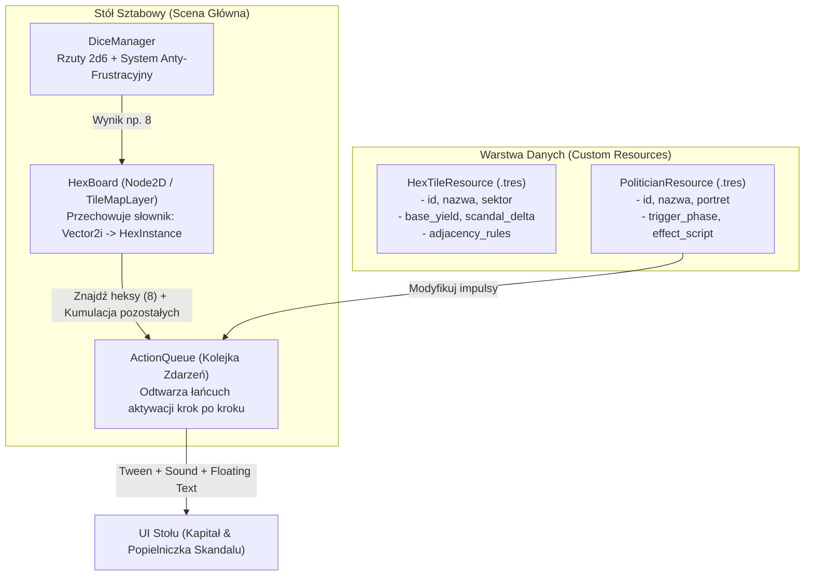

# HEX BARON: THE SMOKE-FILLED ROOM
**Game Design Document (GDD) – v1.0**

> *"W polityce nic nie dzieje się przez przypadek. Jeśli coś się stało, to znaczy, że zostało zaplanowane przy tym stole."*

---

## 1. Wizja Wysokiego Poziomu (High Concept)

* **Tytuł roboczy:** *Hex Baron* (alternatywnie: *The Backroom*, *Shadow Cabinet*, *Smoke & Hexes*)
* **Gatunek:** Single-player Hex-Builder Roguelike / Synergy Engine-Builder
* **Silnik i styl:** Godot 4 (2D) + Pixel Art (Aseprite) z oświetleniem dynamicznym i shaderami post-processingu
* **Główne inspiracje:**
  * *Balatro* (uzależniające synergie, modyfikatory reguł gry, "number go up", soczysty feedback audiowizualny)
  * *Catan* (heksagonalna plansza, numery przypisane do pól, aktywacja rzutem kośćmi)
  * *Terracards / Luck be a Landlord* (ciągła rozbudowa silnika ekonomicznego pod presją rosnących progów punktowych)
* **Klimat i Estetyka ("The Smoke-Filled Room"):**
  Gra przenosi gracza do tajnego, zadymionego gabinetu na szczytach władzy (klimat *House of Cards*, *12 Angry Men*, zimnowojenny gabinet cieni). Gracz wciela się w "Szarą Eminencję" – niewidocznego stratega, który przy ciężkim, mahoniowym stole, wśród popielniczek z dymiącymi cygarami i teczek `TOP SECRET`, rozkłada kafelki wpływów na mapie i kompletuje swój Gabinet Cieni złożony z satyrycznych parodii światowych liderów politycznych.

---

## 2. Kierunek Artystyczny i UI (Single-Screen Experience)

Cała rozgrywka odbywa się na **jednym ekranie** (widok z góry na mahoniowe biurko oświetlone pojedynczą lampą gabinetową):

1. **Góra ekranu – Gabinet Cieni (Sloty na Polityków):**
   * Rząd 5 skórzanych teczek personalnych z napisem `CONFIDENTIAL`.
   * Na każdej teczce przypięte spinaczem zdjęcie (portret 48x48 lub 64x64 px) polityka oraz pieczątka określająca jego specjalizację.
2. **Środek ekranu – Mapa Sztabowa (Hex Grid):**
   * Rozłożona na stole mapa, na której gracz układa heksagonalne kafelki (wykonane w stylu drewnianych/mosiężnych żetonów sztabowych z lekką grubością 2.5D – ok. 4-6 pikseli wysokości boku heksu).
   * Na każdym heksie leży okrągły żeton z numerem aktywacji (od 2 do 12) oraz licznik skumulowanego na nim Kapitału.
3. **Prawa strona – Narzędzia Gabinetu:**
   * **Maszyna do pisania / Terminal:** Wyświetla aktualną Kadencję, numer Kwartału (tury) oraz wymagany **Próg Wyborczy (Quota)**.
   * **Skórzany kubek i 2 kości:** Miejsce rzutu kośćmi oraz żetony **„Wpływów Zakulisowych”** (pozwalające na manipulację rzutem: Reroll lub korektę wyniku +/- 1).
   * **Kryształowa Popielniczka (Wskaźnik Skandalu / Heat):** Im wyższy poziom Skandalu (0–100%), tym gęstszy dym unosi się z popielniczki (`GPUParticles2D`) i tym mocniej czerwienieje lampka ostrzegawcza.
4. **Dół ekranu – Teczka Inwestycyjna / Czarny Rynek:**
   * W trakcie tury: wysuwają się z niej 3 losowe kafelki heksów do położenia na mapie.
   * Po zakończeniu Kadencji: na stół wjeżdża otwarta **Skórzana Walizka**, w której gracz kupuje nowych Polityków, Tajne Dyrektywy i modyfikacje kości.

---

## 3. Pętla Rozgrywki: Kadencje i Kwartały

W przeciwieństwie do *Balatro*, gdzie po każdej rundzie stół jest czyszczony, w *Hex Baron* **mapa rośnie nieprzerwanie przez cały run**.

### Struktura Czasu:
* **1 Kadencja (Term) = 4 Kwartały (Tury).**
* **W każdym Kwartale (Turze) gracz wykonuje 3 kroki:**
  1. **Faza Inwestycji (Rozbudowa Mapy):** Gracz wybiera 1 z 3 wylosowanych kafelków heksów i dokłada go do istniejącej mapy (musi sąsiadować z co najmniej jednym położonym wcześniej kafelkiem).
  2. **Faza Rzutu (Egzekucja):** Gracz wykonuje **3 Rzuty Kośćmi** w ramach jednego Kwartału (lub 1 główny rzut z pulą rzutów w kadencji – do stestowania w balansie MVP; domyślnie: **3 rzuty na Kwartał**). Po każdym rzucie kafelki z wyrzuconą sumą oczek aktywują się i wypłacają **Kapitał Polityczny ($)** do puli Kadencji.
  3. **Faza Rozliczenia Kwartału:** Nieaktywowane kafelki kumulują swoją wartość (patrz Sekcja 4).
* **Koniec 4. Kwartału – Dzień Wyborów (Election Day / Quota):**
  * Gracz musi opłacić z zebranego w danej Kadencji Kapitału wymagany **Próg Wyborczy** (np. Kadencja 1: `500$`, Kadencja 2: `2 000$`, Kadencja 3: `8 000$`, itd.).
  * Jeśli się uda: nadwyżka trafia do **Czarnej Kasy** (waluta do wydania w Walizce Czarnego Rynku), a na stole pojawia się nowy **Kryzys Globalny** (modyfikator na kolejną Kadencję).
  * Jeśli się nie uda: utrata władzy (Game Over).

---

## 4. Mechanika Rzutów Kośćmi i System Anty-Frustracyjny (Kluczowy Filary)

### Problem "Pustych Rzutów"
Na początku gry na planszy znajduje się tylko kilka kafelków (np. 3–5 heksów). Przy standardowym rzucie dwiema kośćmi (`2d6`, wyniki od 2 do 12) istniałoby duże ryzyko, że gracz przez kilka rzutów z rzędu nie trafi w żaden numer obecny na planszy, co prowadziłoby do frustracji.

### Rozwiązanie: 4-warstwowy System Gwarantowanego Postępu

1. **Mechanika "Pęczniejących Obietnic" (Kumulacja i Odsetki na Kafelkach):**
   * **Zasada:** Kafelki produkują Kapitał **w każdej turze**, ale kładą go *na sobie* (jako rosnący stos żetonów na heksie). Rzut kośćmi służy do **Zebrania (Wypłaty / Harvestu)** tych punktów oraz odpalenia efektów specjalnych!
   * **Bonus za Oczekiwanie (Overcharge):** Za każdy rzut, w którym dany kafelek **NIE został trafiony**, jego zgromadzona pula rośnie o swoją bazową wartość powiększoną o **+25% bonusu skumulowanego (Compound Interest)**.
   * *Efekt psychologiczny:* Gdy gracz nie trafia w kafelek "Kopalni" przez 4 rzuty, nie jest wściekły – patrzy, jak Kopalnia "pęcznieje" i świeci się na złoto, wiedząc, że gdy w końcu wypadnie jej numer (lub odpali ją sąsiedni kafelek), nastąpi gigantyczna eksplozja punktów!

2. **Stolica na Numerze "7" (Gwarantowana Kotwica):**
   * Gracz zawsze zaczyna grę z centralnym kafelkiem **Stolicy (Kapitolu)**, który ma przypisany numer **7** (najczęstszy wynik na dwóch kościach `2d6` – aż 16.6% szansy w każdym rzucie).
   * Stolica nie tylko sama daje punkty przy wyrzuceniu `7`, ale posiada wbudowaną cechę: **"Promieniowanie Władzy"** – wyrzucenie `7` pobudza losowy sąsiadujący ze Stolicą kafelek do wypłaty 50% jego zgromadzonego kapitału!

3. **"Odgórne Dotacje" przy pudle (Fail-Safe Trigger):**
   * Jeśli wynik rzutu kośćmi nie pasuje do **żadnego** kafelka na mapie (tzw. *Martwy Rzut*), nie przepada on na marne:
     * Wszystkie kafelki na mapie natychmiast otrzymują **Podwójne Naliczenie Kumulacji** (ich liczniki rosną 2x szybciej).
     * Gracz otrzymuje **1 darmowy Żeton Zakulisowy (+1/-1 do oczka kości)** do wykorzystania w dowolnym kolejnym rzucie!

4. **Inteligentny Rozkład Startowych Żetonów Numerów:**
   * Pierwsze 4 kafelki dokładane przez gracza w Kadencji 1 zawsze losują numery z koszyka wysokiego prawdopodobieństwa: `{5, 6, 8, 9}`. Skrajne numery (`2, 3, 11, 12`) pojawiają się później i mają wbudowany stały mnożnik wartości bazowej (np. kafelek z numerem `2` lub `12` ma z definicji **3x wyższą produkcję bazową** niż kafelek z numerem `6`).

---

## 5. System Punktowania: Reakcje Łańcuchowe i Wskaźnik Skandalu

Zamiast kopiować z *Balatro* pasek `Chips x Mult`, cała matematyka dzieje się **wizualnie na mapie heksów** poprzez **Impulsy (Triggers)**:

1. **Wypłata Bazowa:** Trafiony kością heks wypłaca zgromadzony na sobie Kapitał.
2. **Sąsiedztwo (Adjacency Buffs):** Sąsiednie heksy mogą zwiększać przyrost kapitału lub mnożyć wypłatę w momencie aktywacji.
3. **Przekazanie Impulsu (Chain Reaction / Retrigger):** Niektóre kafelki oraz Politycy pozwalają "podać prąd dalej" – aktywowany kafelek wyzwala sąsiedni kafelek, niezależnie od tego, jaki tamten ma numer kości!
4. **Wskaźnik Skandalu (Heat Meter: 0% – 100%):**
   * Niektóre niezwykle dochodowe kafelki i brudne zagrania generują **+% Skandalu**.
   * Każdy punkt procentowy Skandalu zwiększa ryzyko lub modyfikuje działanie Polityków (niektórzy Politycy mnożą wynik za wysoki Skandal, inni nagradzają za utrzymywanie Skandalu na poziomie 0%).
   * Przekroczenie **100% Skandalu** wywołuje **Komisję Śledczą**: natychmiastową utratę 50% kapitału w bieżącej turze oraz zablokowanie najdroższego kafelka na 1 Kwartał (po czym Skandal spada do 30%).

---

## 6. Katalog Kafelków (5 Sektorów Wpływów)

Każdy kafelek należy do jednego z **5 Sektorów (Typów)**. Dzięki temu Politycy (Jokery) mogą wchodzić w czytelne synergie z całymi gałęziami gospodarki (np. *"Wszystkie kafelki PRZEMYSŁU odpalają się dodatkowy raz"*).

---

### Sektor 1: GOSPODARKA I FINANSE (Kolor: Złoty / Zielony)
*Kafelki skupione na mnożeniu gotówki, odsetkach i kumulacji kapitału.*

| Kafelek | Działanie |
| :--- | :--- |
| **Bank Centralny** | Niska bazowa produkcja, ale zwiększa wypłatę wszystkich sąsiadujących kafelków o **+30%** przy ich aktywacji. |
| **Giełda Papierów** | Za każdy rzut, w którym **nie** została aktywowana, jej bonus kumulacji wynosi aż **+50%** zamiast +25%. Jeśli jednak wypadnie `7`, traci połowę uzbieranej puli (ryzyko krachu!). |
| **Raj Podatkowy** | Kiedy sąsiadujący kafelek wypłaca Kapitał, Raj Podatkowy kopiuje **25% tej kwoty** i odkłada na własnym liczniku (bez zużywania jej u sąsiada). |
| **Centrum Handlowe** | Daje bazowo `+15$` za każdy sąsiadujący z nim kafelek typu *Społeczeństwo* lub *Infrastruktura*. |

---

### Sektor 2: PRZEMYSŁ I SUROWCE (Kolor: Rdzawy / Stalowy)
*Ogromna produkcja bazowa kosztem generowania Skandalu (Zanieczyszczenia) lub niszczenia otoczenia.*

| Kafelek | Działanie |
| :--- | :--- |
| **Kopalnia Węgla** | Bardzo wysoka produkcja bazowa (`+50$`). Każda wypłata generuje **+5% Skandalu**. |
| **Pole Naftowe** | Daje **x2 wypłaty**, jeśli sąsiaduje z innym *Polem Naftowym* lub *Rafinerią*. |
| **Fabryka Zbrojeniowa** | Zwiększa swoją bazową produkcję o `+20$` na stałe za każdym razem, gdy na mapie zostanie zniszczony dowolny kafelek lub gdy Skandal przekroczy 50%. |
| **Elektrownia Atomowa** | Przy swojej aktywacji **doładowuje (+100% dziennej produkcji)** wszystkie sąsiadujące z nią kafelki (6 pól wokół). Generuje **+10% Skandalu**. |

---

### Sektor 3: MEDIA I PROPAGANDA (Kolor: Fioletowy / Neonowy)
*Kontrola Wskaźnika Skandalu, kopiowanie efektów i przekazywanie impulsów.*

| Kafelek | Działanie |
| :--- | :--- |
| **Stacja Telewizyjna** | Przy aktywacji **redukuje Skandal o -15%** i wypłaca dodatkowe `+10$` za każdy zredukowany procent. |
| **Farma Trolli** | Niska produkcja własna, ale przy aktywacji **przekazuje Impuls (aktywuje)** losowy sąsiedni kafelek i podnosi Skandal o +5%. |
| **Gazeta Codzienna** | Kopiuje numer kości z najdroższego sąsiadującego z nią kafelka (zmienia swój numer dynamicznie!). |
| **Agencja PR** | Sprawia, że sąsiadujące z nią kafelki *Przemysłu* oraz *Służb* przestają generować Skandal. |

---

### Sektor 4: SPOŁECZEŃSTWO I URBANISTYKA (Kolor: Niebieski / Ceglany)
*Kafelki skalujące się od ilości – im większa aglomeracja, tym większe zyski (Głosy = Kapitał).*

| Kafelek | Działanie |
| :--- | :--- |
| **Osiedle (Blokowisko)** | Daje bazowo niewiele (`+15$`), ale otrzymuje **+20$ za każde inne Osiedle** z którym bezpośrednio sąsiaduje. |
| **Uniwersytet** | Co Kwartał na stałe podnosi bazową produkcję losowego sąsiadującego kafelka o `+5$`. |
| **Kasyno** | Przy aktywacji rzuca własną mini-kością: 50% szans na podwojenie swojej puli przed wypłatą, 50% szans na wypłatę tylko połowy. |
| **Stadion Narodowy** | Aktywuje się automatycznie za każdym razem, gdy na kościach wypadnie **dublet** (np. 2+2, 4+4, 6+6), niezależnie od swojego numeru! |

---

### Sektor 5: SŁUŻBY I INFRASTRUKTURA (Kolor: Czerwony / Czarny)
*Łączenie odległych części mapy, manipulacja kośćmi i brudne operacje specjalne.*

| Kafelek | Działanie |
| :--- | :--- |
| **Autostrada / Węzeł** | Sama nie produkuje pieniędzy, ale działa jak **przewodnik**: gdy dowolny sąsiadujący z nią kafelek się aktywuje, Autostrada przekazuje impuls na kafelek po swojej przeciwnej stronie! |
| **Baza Wojskowa** | Pobiera 20% haraczu z sąsiednich kafelków, ale przy własnej aktywacji wypłaca zgromadzoną pulę pomnożoną przez **x2.5**. |
| **Sąd Najwyższy** | Gdy zostaje aktywowany, daje graczowi **+1 Żeton Zakulisowy** (manipulacja kością) i zeruje karę z aktualnego Kryzysu na 1 rzut. |
| **Tajne Więzienie (Black Site)** | Ukrywa wszystkie sąsiednie kafelki przed negatywnymi efektami Kryzysów, ale dodaje stałe **+8% Skandalu** co Kwartał. |

---

## 7. "Gabinet Cieni" – Międzynarodowe Ikony Polityki (Jokery)

Politycy siedzą w 5 teczkach nad mapą. Każdy z nich powiązany jest z konkretnymi **Sektorami Kafelków**, **Kośćmi** lub **Skandalem**:

1. **Donald Tramp (*"The Dealbuilder"*) – [Społeczeństwo / Gospodarka]**
   * *Mechanika:* Wszystkie kafelki **otoczone z 6 stron** innymi kafelkami (całkowicie zabudowane) otrzymują mnożnik wypłaty **x2.5**. Dodatkowo na koniec Kadencji daje +1 darmowy kafelek *Kasyna* lub *Banku*.
2. **Vlad Car-Putler (*"Oligarcha Rurociągów"*) – [Przemysł]**
   * *Mechanika:* Wszystkie kafelki z sektora **Przemysł**, które tworzą nieprzerwany łańcuch na mapie, **aktywują się jednocześnie**, gdy choć jeden z nich zostanie trafiony rzutem kości! (Każda taka kaskada daje +5% Skandalu).
3. **Margaret Hatcher (*"Żelazna Prywatyzacja"*) – [Przemysł -> Gospodarka]**
   * *Mechanika:* Na koniec każdego Kwartału **zamyka (niszczy) 1 losowy kafelek Przemysłu** na mapie. W zamian wszystkie kafelki **Gospodarki** otrzymują permanentny mnożnik **+0.3x** do końca gry.
4. **Angela Mark (*"Kanclerz Stabilności"*) – [Kości / Gospodarka]**
   * *Mechanika:* Spłaszcza ryzyko: Twoje kości nie mogą wyrzucić sumy mniejszej niż `5` ani większej niż `9`. Kafelki z numerami `6, 7, 8` kumulują kapitał o **+20% szybciej**.
5. **Javier Mil-Chainsaw (*"Człowiek z Piłą"*) – [Niszczenie / Gospodarka]**
   * *Mechanika:* Raz na Kwartał pozwala użyć **Piły Łańcuchowej**, aby usunąć dowolny kafelek ze stołu i natychmiast wypłacić 300% jego aktualnej wartości. Za każdy usunięty kafelek w grze otrzymujesz stałe **+15% do wypłat wszystkich kafelków**.
6. **Silvio Bunga (*"Magnat Telewizyjny"*) – [Media / Skandal]**
   * *Mechanika:* Kafelki z sektora **Media** wypłacają podwójnie, a każdy punkt procentowy **Skandalu** na popielniczce zwiększa produkcję *Stacji TV* i *Kasyn* o **+2%**.
7. **Kim Rocket (*"Supreme Atom"*) – [Służby / Przemysł]**
   * *Mechanika:* Kafelki **Baz Wojskowych** i **Elektrowni Atomowych** przy swojej aktywacji odpalają **wszystkie** sąsiednie pola wokół siebie (100% szansy na retrigger sąsiadów).
8. **Bernie Senders (*"Podatek od Miliarderów"*) – [Społeczeństwo vs Gospodarka]**
   * *Mechanika:* Kafelki *Gospodarki* tracą 50% swojej wartości, ale za każdy posiadany kafelek *Gospodarki* wszystkie **Osiedla i Uniwersytety** na planszy dostają **+40$ bazowej produkcji**.
9. **Szejk Al-Petrol (*"Złoty Piasek"*) – [Przemysł / Mapa]**
   * *Mechanika:* Każde *Pole Naftowe* zyskuje **+30$ bazowej produkcji** za każdą **pustą (niezabudowaną)** krawędź wokół siebie. Nagradza budowanie rzadkich, rozproszonych odwiertów na obrzeżach mapy!
10. **Wujek Joe (*"Drzemka Strategiczna"*) – [Rytm Rzutów]**
    * *Mechanika:* Podczas 1. i 2. rzutu kośćmi w Kwartale żadne kafelki się nie aktywują (wszystkie tylko kumulują punkty w tempie x2). W **3. (ostatnim) rzucie** aktywują się ze **skumulowanym mnożnikiem x3**!

---

## 8. Architektura Techniczna pod Godot 4 (Plan MVP)

Projekt jest zaprojektowany tak, aby maksymalnie wykorzystać wbudowane systemy Godota 4 i uniknąć pisania skomplikowanego kodu:

### Kluczowe decyzje inżynieryjne:
1. **Reprezentacja Siatki Heksów (`Vector2i` Axial/Offset Coordinates):**
   * Zamiast czystego `TileMapLayer` (który rysuje tylko statyczne obrazki), użyjemy matematyki siatki heksagonalnej (`TileMapLayer` jako pomocnik do przeliczania pozycji `local_to_map` i `get_surrounding_cells`), ale każdy położony heks będzie instancją lekkiej sceny `HexTile.tscn` (`Node2D`).
   * Dlaczego? Bo dzięki temu każdy heks może się niezależnie **trząść, podskakiwać przy wypłacie (`Tween`), świecić i wyświetlać swój licznik skumulowanych pieniędzy**!
2. **Kolejka Wizualna (`EvaluationQueue`):**
   * Kiedy gracz rzuca kośćmi, gra w ułamku sekundy oblicza logikę, ale wrzuca każde zdarzenie (`ActivateHex`, `TriggerNeighbor`, `TriggerPolitician`, `AddCash`) do tablicy.
   * Następnie odtwarza je w pętli z krótkim opóźnieniem (np. `0.18s`, przyspieszającym z każdym kolejnym ogniwem łańcucha do `0.05s`) i podwyższającym się tonem dźwięku (`AudioStreamPlayer.pitch_scale += 0.05`). To daje dokładnie ten sam zastrzyk dopaminy co *Balatro*.

---

## 9. Roadmapa Produkcyjna (Kamienie Milowe)

### Etap 1: "Szary Gabinet" – Prototyp Mechaniczny (Tydzień 1–2)
* [ ] Stworzenie matematyki siatki heksów (kładzenie kafelka obok istniejących, wykrywanie 6 sąsiadów).
* [ ] Zaimplementowanie rzutu 2 kośćmi, Stolicy na "7" oraz **Systemu Kumulacji (+25% za brak trafienia)**.
* [ ] Zrobienie Kolejki Zdarzeń (wizualne przeskakiwanie impulsu z heksu na heks z wyskakującymi liczbami `+$`).
* [ ] 5 podstawowych kafelków (po 1 z każdego Sektora) i 3 testowych Polityków.

### Etap 2: "Dym i Mahoń" – Oprawa Aseprite & Juice (Tydzień 3–4)
* [ ] Narysowanie w Aseprite mahoniowego stołu, szablonu heksu 2.5D, teczek `TOP SECRET` i popielniczki.
* [ ] Dodanie cząsteczek dymu (`GPUParticles2D`), cienia lampy gabinetowej (shader winiety) oraz dźwięków maszyny do pisania i rzucanych kości.
* [ ] Implementacja Wskaźnika Skandalu (Heat) oraz Walizki Czarnego Rynku (sklepu po Kadencji).

### Etap 3: Rozbudowa Contentu i Balans (Tydzień 5–8)
* [ ] Rozbudowa puli do 20 kafelków (4 na Sektor) oraz 15–20 Polityków.
* [ ] Dodanie Tajnych Dyrektyw (kart jednorazowych, np. zamiana numerów na mapie, wyciszenie skandalu).
* [ ] Przygotowanie wersji Demo pod testy ze znajomymi / Steam Next Fest.
